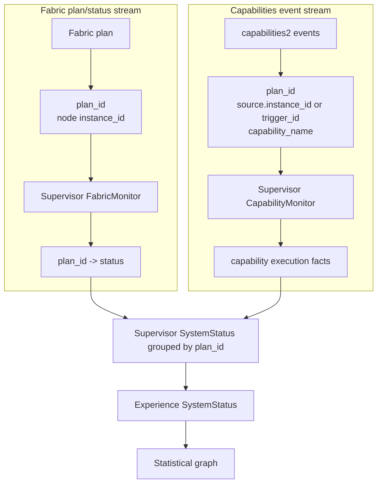

# Data To Knowledge Store

The experience system stores knowledge in two linked places.

- The **semantic graph** stores meaning: capabilities, task entities, context
	entities, plan patterns, dependencies, recovery relationships, and fault
	descriptions.
- The **statistical graph** stores measurements: success counts, runtime,
	battery cost, fault rates, resource use when available, and uncertainty
	evidence.

The key idea is simple: **semantic data says what is relevant; statistical data
says what has worked.** Planning needs both.

## What Gets Inserted

The main inputs are:

| Input | Where it goes | Why |
|---|---|---|
| Supervisor `SystemStatus` messages | statistical graph and selected semantic fields | update runtime evidence, context, and fault concepts |
| Capability metadata | semantic graph and vector index | find capabilities that match a task and preserve how the local system realizes them |
| `related_nodes[]` | semantic graph | record dependency or interaction context |
| Log source and description | semantic graph | support fault search and explanations |
| Log severity label | statistical graph | count warnings and errors |
| Run evidence counters | statistical graph | estimate success probability |
| Start/stop intervals | statistical graph | estimate runtime |
| Battery deltas | statistical graph | estimate energy cost |
| Prior plan graphs | both graphs | learn plan relationships and outcomes |
| External task context and plan feedback | both graphs | condition estimates and calibrate whole-plan success |

In the current implementation, the supervisor publishes
`supervisor_msgs/msg/SystemStatus` on the `system_status` topic. The experience
server subscribes to that topic, converts the message into its internal
`SystemStatus` structure, and owns the accumulation and estimation rules.

The next semantic ingestion step is to internalize capabilities2 metadata
handling behind a dedicated capabilities interface plugin. That plugin should
request runnable specs from `capabilities2`, parse the YAML locally, and emit
normalized experience-side metadata records that keep both `behaviour_name`
and `implementation_name`.

## Runtime Evidence Identity Flow

Fabric plan status and capability execution events are observed as parallel
streams and joined in the supervisor by `plan_id`.



The supervisor skill tracking key is:

```text
plan_id + "/" + instance_id + "/" + skill_name
```

Experience normalizes each key segment before using it as a storage ID. The
original skill name is still stored with the row for display and traceability.

`CapabilityMonitor` records capability-side execution evidence using `plan_id`,
`instance_id`, and `capability_name`, where `plan_id` comes from the emitted
capability event connection ownership. `FabricMonitor` records plan-side state
using `plan_id` and `fabric_status`. `SupervisorServer` is the join point: it
groups capability records by `plan_id`, attaches the matching Fabric status,
and publishes one `SystemStatus` per plan group. The Experience-side internal
runtime model stores that plan state as `behaviour_plan_state`.

Rows whose capability events do not carry a `plan_id` remain in an unknown-plan
group and are not assigned to the latest Fabric execution.

## Skill Run Statistics Table

Runtime evidence is persisted in a single `skill_run_statistics` table.
Each row represents one skill execution window and is updated in place
while the execution is active. The same row becomes history when it is marked
finalized.

The primary key is the normalized execution window ID:

```text
normalize(plan_id) + "/" + normalize(instance_id) + "/" + normalize(skill_name)
```

The row stores the original `plan_id`, `bond_id`, `instance_id`,
`skill_name`, Fabric status, lifecycle state, cumulative run counters,
start/stop timestamps, the latest outcome, and provenance fields. Provenance
currently includes the estimator window, source message timestamp, selected
context key, and missing-field flags.

Finalization is monotonic: once a row is finalized by Fabric terminal status or
capability terminal evidence, later updates cannot mark it active again.

## Semantic Graph Write Path

Semantic writes create nodes such as capabilities, task entities, context
entities, plan patterns, and fault concepts.

For capability metadata, the source split should be explicit:

- interfaces define what a capability means,
- providers and runnable specs define how the current system realizes it.

Because one interface can have multiple providers, the semantic graph input
needs to preserve both interface identity and provider identity even when the
initial graph node is capability-centric.

The current Experience decision is to keep capability nodes interface-level for
retrieval and graph structure, while attaching provider identity as metadata on
those nodes. That keeps declared relation targets stable, because relations are
still expressed at the interface layer in the current capabilities2 data.

They also create relationships such as:

- capability depends on another capability,
- capability interacts with a task object or environment,
- capability can do a task objective,
- one capability often precedes another,
- one capability is used as recovery for another.

Declared relationships and parameter schemas should come from capability
metadata before LLM extraction is used as a secondary enrichment step.

When runtime output parameters from one capability match runtime input
parameters of another, Experience should also persist a semantic
capability-to-capability parameter-flow edge. That edge is stronger than a
purely textual relation because it captures executable interface
compatibility.

This graph is used for retrieval and reasoning. It should not be treated as a
source of numeric reliability.

## Statistical Graph Write Path

Statistical writes update numeric evidence for a capability and comparable
context. The experience layer accumulates this evidence over time.

Examples:

- success probability from successful and completed runs,
- expected runtime from completed intervals,
- expected battery cost from per-run battery deltas,
- fault burden from warning/error rates,
- uncertainty from sparse samples, missing telemetry, and unfamiliar context.

Before counters are updated, event labels need their current meaning:
`TRIGGERED` starts a run, `SUCCEEDED` marks success, `FAILED` marks failed
completion, and `TERMINATED` marks cancellation or external stop. `STARTED`,
`STOPPED`, `DISCONNECTED`, and `UNDEFINED` are lifecycle/provenance states, not
successful task outcomes by themselves.

The current supervisor data does not yet include real CPU, memory, network,
storage, or actuator measurements. Until that exists, resource demand is marked
missing rather than guessed from `related_nodes[]`.

## How The Two Stores Connect

Both graphs share stable IDs for capabilities and context buckets.
That lets planning do this:

1. use the semantic graph to find relevant capability candidates,
2. join those candidates to statistical evidence,
3. estimate the feature vector $x_i=[p_i,t_i,e_i,f_i,\\mathbf{r}_i,u_i]$,
4. send those estimates to RAPFS for plan ranking.

Keeping the stores separate avoids a common mistake: a capability can be
semantically relevant but empirically unreliable.
