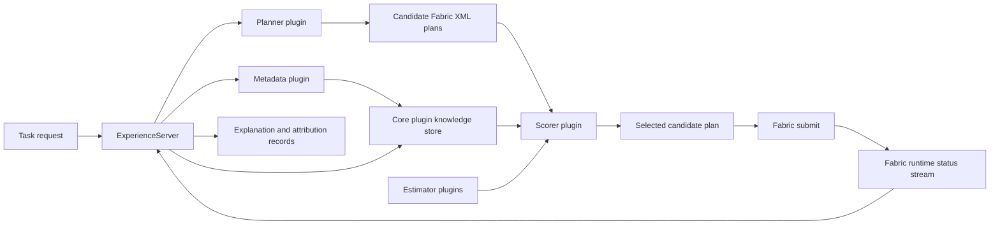

# Implementation Pipeline

This document ties the current Experience implementation together as one end-to-end process pipeline. It is intended to answer a practical question:

How does a task request move through Experience, become candidate plans, get scored, get executed through Fabric, and then feed runtime evidence back into the knowledge store?

Use this document as the top-level map. The detailed semantics, equations, and storage rules live in the linked package docs and design notes.

## Pipeline Overview



## Stage 1: External Request Enters Experience

The process starts when Fabric or another caller sends a planning request to the Experience action interface. Experience sits between the user task description and executable Fabric plans.

At this boundary:

- the request is normalized into an internal `fabric::planning::Request`,
- a `planning_request_id` is created,
- the current plugin stack is already loaded by `experience_server`.

Primary package:

- [experience_server](../experience_server)

Related docs:

- [External Input](external_input.md)
- [Fabric To Internal Structs](fabric_to_internal_structs.md)

## Stage 2: Capability Metadata Is Loaded

Before planning, Experience needs a view of what the robot can do. The metadata plugin requests runnable capability data from capabilities2, parses it, and emits Experience-side records that preserve both interface identity and implementation identity.

This stage answers:

- what skills are available,
- which provider implements each skill,
- what declared relationships exist between skills.

Primary packages:

- [experience_interface_capabilities](../experience_interface_capabilities)
- [experience_base](../experience_base)

Related docs:

- [Data To Knowledge](data_to_knowledge.md)
- [Capabilities2 To Internal Structs](capabilities2_to_internal_structs.md)
- [Knowledge Representation](knowledge_representation.md)

## Stage 3: Knowledge Is Built And Updated

The core plugin owns the persistent knowledge representation used by planning and scoring. In the current default stack this is the GraphRAG-style core plugin.

The knowledge layer is split into two connected stores:

- a semantic graph for meaning, retrieval, and relationships,
- a statistical graph for empirical execution evidence.

Semantic data preserves things like:

- capability identity,
- provider metadata,
- task and context entities,
- dependency and recovery relationships.

Statistical data preserves things like:

- success and failure counts,
- runtime intervals,
- battery deltas,
- warning and error burden,
- missing evidence and uncertainty signals.

Primary packages:

- [experience_core_grag](../experience_core_grag)
- [experience_base](../experience_base)

Related docs:

- [Data To Knowledge](data_to_knowledge.md)
- [Knowledge Representation](knowledge_representation.md)
- [Data To Equation Bridge](data_to_equation_bridge.md)

## Stage 4: Candidate Plans Are Generated

The planner plugin receives:

- the user task description,
- available capability metadata,
- retrieved knowledge and fallback evidence.

It then uses PromptTools to generate candidate Fabric XML plans, critique them, and refine them. Experience does not score free-form text plans directly. It scores structured candidate plans that have already been converted into Experience-owned plan data.

This stage produces:

- candidate Fabric XML plans,
- parsed candidate nodes and edges,
- stable candidate-plan IDs and graph hashes.

Primary packages:

- [experience_planner](../experience_planner)
- [experience_base](../experience_base)

Related docs:

- [Plan Ranking And Selection](plan_ranking_selections.md)
- [Fabric To Internal Structs](fabric_to_internal_structs.md)

## Stage 5: Candidate Nodes Are Resolved To Stable IDs

Before any score is computed, each candidate runner node is resolved to stable capability and context identity through the core plugin. This is the key boundary that keeps scorer logic from reaching directly into storage internals.

The scorer asks the core plugin for:

- resolved capability identity,
- resolved context key and context class,
- best available statistical evidence,
- explanation of which fallback level was used.

This stage is where candidate nodes become scoreable entities rather than anonymous XML runners.

Primary packages:

- [experience_base](../experience_base)
- [experience_core_grag](../experience_core_grag)
- [experience_scorer_rapfs](../experience_scorer_rapfs)

Related docs:

- [Knowledge To RAPFS](knowledge_to_rapfs.md)
- [Plan Ranking And Selection](plan_ranking_selections.md)

## Stage 6: Estimators Turn Evidence Into Features

Estimator plugins convert resolved evidence into the per-node feature vector used by RAPFS:

$$
x_i = [p_i, t_i, e_i, f_i, r_i, u_i]
$$

where:

- $p_i$ is success probability,
- $t_i$ is expected runtime,
- $e_i$ is expected energy cost,
- $f_i$ is expected fault burden,
- $r_i$ is expected resource demand,
- $u_i$ is uncertainty.

In the current stack:

- success uses beta-smoothed posterior estimates,
- uncertainty includes estimator-side statistical uncertainty,
- the final scorer composes uncertainty from multiple factors rather than trusting a single raw estimator output.

Primary packages:

- [experience_estimator](../experience_estimator)
- [experience_base](../experience_base)

Related docs:

- [Knowledge To RAPFS](knowledge_to_rapfs.md)
- [Risk-Aware Plan Feasibility Score](risk_aware_plan_score.md)
- [Data To Equation Bridge](data_to_equation_bridge.md)

## Stage 7: RAPFS Scorer Aggregates Whole Plans

The scorer plugin owns plan-level ranking policy. In the current implementation, that plugin is `experience::RapfsScorerPlugin` from the `experience_scorer_rapfs` package.

The scorer:

- loads scoring transforms and feasibility thresholds from ROS parameters,
- requests evidence through `CoreBase`,
- runs estimator plugins for each node,
- composes uncertainty from statistical, ambiguity, unfamiliarity, and missing-evidence terms,
- walks the original Fabric XML control tree,
- aggregates node-level estimates into whole-plan metrics,
- applies hard feasibility thresholds,
- computes final RAPFS values,
- selects the best feasible candidate.

The current XML-aware aggregation supports:

- `sequential`,
- `parallel_all`,
- `parallel_any`,
- `recovery`.

Primary packages:

- [experience_scorer_rapfs](../experience_scorer_rapfs)
- [experience_base](../experience_base)

Related docs:

- [Risk-Aware Plan Feasibility Score](risk_aware_plan_score.md)
- [Knowledge To RAPFS](knowledge_to_rapfs.md)
- [Plan Ranking And Selection](plan_ranking_selections.md)

## Stage 8: Selected Plan Is Submitted For Execution

After scoring, Experience returns the selected candidate plan and its metadata. Fabric owns the execution submission boundary.

The selected plan can be submitted together with:

- `planning_request_id`,
- `candidate_plan_id`,
- `graph_hash`.

Those metadata fields are critical because they later let Experience join runtime outcomes back to the exact candidate that was scored.

Primary packages:

- [experience_server](../experience_server)
- [experience_interface_fabric](../experience_interface_fabric)

Related docs:

- [Fabric To Internal Structs](fabric_to_internal_structs.md)
- [External Input](external_input.md)

## Stage 9: Fabric Publishes And Enriches Runtime Evidence

During and after execution, Fabric collects plan state and capability execution evidence, joins them by `plan_id`, and emits Fabric-owned `SystemStatus` snapshots.

Experience subscribes to those snapshots and converts them into internal runtime records.

This stage is where plan execution becomes empirical evidence.

It provides:

- lifecycle transitions,
- success and failure labels,
- runtime windows,
- battery deltas,
- warnings and errors,
- propagated plan metadata needed for plan-to-outcome correlation.

Primary packages:

- [experience_server](../experience_server)
- [experience_core_grag](../experience_core_grag)

Related docs:

- [Data To Knowledge](data_to_knowledge.md)
- [External Input](external_input.md)
- [Data To Equation Bridge](data_to_equation_bridge.md)

## Stage 10: Evidence Is Persisted And Reused

The incoming runtime evidence updates the knowledge store. Future planning requests can then retrieve:

- exact-context evidence,
- broader context-class evidence,
- capability-level aggregate evidence,
- default priors when empirical data is missing.

That means Experience improves the next planning decision without changing the planner prompt alone. The empirical execution record is part of the planning loop.

Primary packages:

- [experience_core_grag](../experience_core_grag)
- [experience_server](../experience_server)

Related docs:

- [Data To Knowledge](data_to_knowledge.md)
- [Knowledge To RAPFS](knowledge_to_rapfs.md)
- [Knowledge Representation](knowledge_representation.md)

## Stage 11: Explanations And Attribution Are Stored

For the selected plan, Experience stores score explanations and attribution artifacts that make debugging possible later.

These records include:

- plan identity,
- candidate identity,
- graph hash,
- resolved capability and context IDs,
- fallback provenance,
- estimator outputs,
- RAPFS-aligned feature vectors,
- plan-level aggregated score components,
- feasibility outcome,
- scoring version metadata.

This is the practical observability layer for the pipeline. Without it, there is no reliable way to understand why one plan was selected over another.

Primary packages:

- [experience_server](../experience_server)
- [experience_scorer_rapfs](../experience_scorer_rapfs)

Related docs:

- [Knowledge To RAPFS](knowledge_to_rapfs.md)
- [External Input](external_input.md)

## Runtime Example: Selected Plan To Stored Explanation Record

This example shows the concrete identity flow after Experience selects one candidate plan.

### 1. Planning request arrives

Assume the user asks:

```text
deliver the medicine tray to room 4
```

Experience creates an internal planning request like:

```text
planning_request_id = pr_20260818_104512
```

### 2. Planner returns multiple candidate plans

Assume the planner returns two candidate Fabric XML plans. After scoring, Experience selects one candidate with:

```text
candidate_plan_id = cp_a17
graph_hash = 3e7f2c91
```

The selected plan might contain runner nodes like:

```text
runner_0 = Navigate(provider=navigation_stack_a)
runner_1 = PickTray(provider=arm_stack_b)
runner_2 = DeliverTray(provider=delivery_stack_a)
```

### 3. Scorer resolves node identity and stores score details

Before selection is finalized, the scorer resolves each runner through `CoreBase`, retrieves evidence, runs estimators, and stores plan-node explanation content such as:

```text
candidate_node_id = runner_1
skill_id = picktray
context_key = deliver_medicine_tray_to_room_4
fallback_level = exact_context
feature_vector = [0.91, 14.2, 2.8, 0.05, 0.0, 0.18]
```

At the plan level, the scorer also records summary fields such as:

```text
terminal_success_estimate = 0.83
expected_runtime_seconds = 48.6
expected_energy_delta_percentage = 6.7
expected_fault_burden = 0.12
expected_uncertainty = 0.24
feasible = true
final_rapfs = 0.41
```

### 4. Fabric executes the selected plan with metadata

When the selected plan is submitted, Fabric metadata carries the plan identity forward:

```text
planning_request_id = pr_20260818_104512
candidate_plan_id = cp_a17
graph_hash = 3e7f2c91
```

These fields move through `/fabric/status` and then into Fabric-owned `SystemStatus` snapshots.

### 5. Fabric publishes terminal execution evidence

Assume execution finishes with:

```text
plan_id = fabric_plan_884
planning_request_id = pr_20260818_104512
candidate_plan_id = cp_a17
graph_hash = 3e7f2c91
behaviour_plan_state = SUCCEEDED
```

Experience now has enough information to join the terminal runtime outcome back to the exact scored candidate plan rather than only to a generic task string.

### 6. Experience stores the explanation record

The stored explanation record is keyed by the selected-candidate identity:

```text
(planning_request_id, candidate_plan_id, graph_hash)
= (pr_20260818_104512, cp_a17, 3e7f2c91)
```

That record can then contain:

- selected plan outcome,
- feasibility result,
- scoring version metadata,
- per-node fallback provenance,
- estimator outputs,
- fixed RAPFS-aligned node feature vectors,
- whole-plan aggregated score components.

### 7. Operator or developer retrieves the stored explanation

The selected explanation can later be queried with:

```bash
ros2 run experience_server get_plan_score_explanation.py pr_20260818_104512 cp_a17 3e7f2c91
```

And a node-level explanation can be inspected with:

```bash
ros2 run experience_server get_plan_score_explanation.py pr_20260818_104512 cp_a17 3e7f2c91 --candidate-node-id runner_1
```

The important implementation point is that the explanation record is not just a score dump. It is a joinable artifact that binds together:

- the original planning request,
- the selected candidate plan,
- the exact graph shape that was scored,
- the node-level evidence and fallback path,
- the eventual execution outcome.

This is what makes post-hoc debugging, calibration, and scorer comparison possible.

## Current Plugin Responsibilities

The current implementation is intentionally split by responsibility.

| Responsibility | Main package | Role in pipeline |
|---|---|---|
| Server orchestration | [experience_server](../experience_server) | ROS entrypoints, plugin loading, plan/explanation services, runtime ingestion |
| Shared contracts | [experience_base](../experience_base) | Base interfaces and internal planning/runtime structs |
| Capability metadata | [experience_interface_capabilities](../experience_interface_capabilities) | Runnable capability discovery and normalization |
| Runtime telemetry adapter | `fabric_server` + Experience runtime ingestion | Convert Fabric-owned runtime evidence into Experience runtime structures |
| Core knowledge | [experience_core_grag](../experience_core_grag) | Semantic/statistical knowledge, retrieval, identity resolution, evidence lookup |
| Planning | [experience_planner](../experience_planner) | Candidate plan generation and refinement |
| Feature estimation | [experience_estimator](../experience_estimator) | Convert evidence into node-level estimate outputs |
| Plan scoring | [experience_scorer_rapfs](../experience_scorer_rapfs) | Aggregate candidates and rank them with RAPFS |

## Extension Path: Long-Horizon Mission Staging

One natural extension is to support missions whose end-to-end objective is valid, but whose full candidate plan exceeds the currently available time, energy, or other cumulative budgets. That behavior should sit above the current candidate-planning loop rather than inside the scorer.

The current server boundary is still the right one for local decision making:

- the planner generates candidate Fabric XML plans,
- validators reject malformed or unsatisfied candidates,
- the scorer applies RAPFS and feasibility thresholds,
- the server returns one selected candidate together with explanation metadata,
- Fabric runtime feedback updates the evidence store after execution.

To support budget-driven decomposition without breaking the plugin design, add a mission-staging layer that reuses those same boundaries instead of replacing them.

### What The New Layer Does

The new layer would own logic such as:

- detect when the best full-mission candidate is infeasible because it exceeds current time, energy, or other mission budgets,
- decide whether the task can be segmented into smaller subgoals,
- request a candidate plan for the next segment only,
- insert maintenance or support actions such as charging, waiting, parking, or human handoff,
- queue later segments for future submission,
- trigger replanning after each segment using updated telemetry and world state.

In other words, the scorer still answers "which candidate is best right now?" while the mission layer answers "how should this objective be staged over time?"

### How To Add It Without Breaking Existing Plugins

The cleanest path is to keep the existing plugin contracts for planning, validation, estimation, and scoring unchanged, and introduce one new orchestration surface above them.

Recommended shape:

1. Add a mission-level coordinator inside `experience_server` or as a sibling node that calls the existing `experience/plan/generate` action repeatedly.
2. Extend the planning request model with optional mission metadata such as remaining budget, mission phase, prior completed segments, and resumability constraints.
3. Let the planner continue to produce ordinary candidate plans, but allow it to optionally target a requested segment or subgoal instead of the full mission.
4. Preserve validators and scorers exactly as they are so each segment is still checked and ranked using the existing RAPFS pipeline.
5. Carry forward mission context and prior segment identifiers in the metadata so Fabric outcomes can be joined both per-segment and per-mission.
6. Insert support actions such as charging through the same plan generation boundary rather than by hard-coding them into the scorer.

This keeps RAPFS local, interpretable, and reusable. It also avoids pushing temporal scheduling concerns into plugin interfaces that currently operate on one candidate set at a time.

### Minimal Server Changes

The current server can evolve incrementally.

- Keep `handleGeneratePlan` as the single-request planning entrypoint for one candidate set.
- Add a mission-oriented service or action, for example `experience/mission/generate`, that can orchestrate multiple `GeneratePlan` requests.
- Introduce a small mission-state record keyed by a stable mission ID, storing remaining goals, remaining budget, queued segments, and completion evidence.
- Reuse the existing explanation persistence so each submitted segment still has its own `(planning_request_id, candidate_plan_id, graph_hash)` trace.
- Add a mission-level summary artifact that links those per-segment records into one execution story.

With that structure, the current plan scoring path remains untouched. The new code lives at the orchestration layer, where queueing, charging insertion, defer-and-resume behavior, and budget refresh naturally belong.

### Why This Is Not An Optimizer Plugin

Although the trigger may be a feasibility or budget violation, the resulting behavior is not just local candidate refinement. It needs explicit representations for partial completion, segment boundaries, mission progress, support-action insertion, and resubmission policy. Those are cross-request concerns, so they fit better in a mission coordinator than in a single-plan optimizer hook.

## Current Limits

Some parts of the pipeline are structurally present but still empirically incomplete.

- Quantitative resource telemetry is still missing, so the resource term is only weakly informed.
- Branching aggregation now follows the original Fabric XML control tree, but future exact inference or Monte Carlo evaluation is still a valid next step.
- Piecewise-linear transforms and thresholds are configurable and versioned, but they still need stronger empirical calibration.

## Reading Order

If you want to understand the system from top to bottom, use this order:

1. [README](../README.md)
2. [Implementation Pipeline](implementation.md)
3. [Fabric To Internal Structs](fabric_to_internal_structs.md)
4. [Data To Knowledge](data_to_knowledge.md)
5. [Knowledge Representation](knowledge_representation.md)
6. [Knowledge To RAPFS](knowledge_to_rapfs.md)
7. [Risk-Aware Plan Feasibility Score](risk_aware_plan_score.md)
8. [Plan Ranking And Selection](plan_ranking_selections.md)
9. [External Input](external_input.md)
